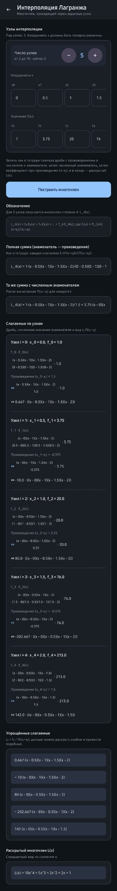
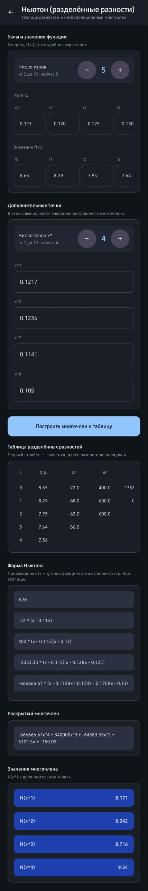
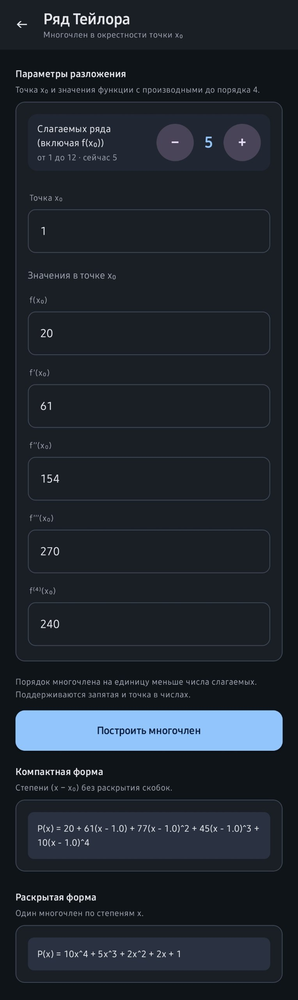

# Applied Theory of Computational Methods — Kotlin Multiplatform App

An Android + iOS app for **numerical methods**: polynomial interpolation, Taylor expansion,
Newton's method for equations and the characteristic polynomial of a matrix. Built from a single
Kotlin codebase with **Kotlin Multiplatform** and **Compose Multiplatform**.

You enter the data, and the app shows the full working, the way it is written in a notebook:
divided-difference tables, fractions with products, the polynomial in its classic form and in
expanded form, and every iteration step.

| Lagrange | Newton (divided differences) | Taylor |
|---|---|---|
|  |  |  |

## Methods

| Method | What the app shows |
|---|---|
| **Lagrange interpolation** | Each term as a fraction of products, numeric denominators, simplified terms and the expanded polynomial |
| **Newton interpolation** | Divided-difference table, Newton form, expanded polynomial and its values at extra points |
| **Taylor polynomial** | Polynomial around `x₀` from given derivatives, in compact and expanded form |
| **Newton's method for f(x) = 0** | Iteration table `xₖ, f(xₖ), f'(xₖ), xₖ₊₁` until the step is below ε |
| **Faddeev–Leverrier** | Characteristic polynomial `det(λI − A)` with every intermediate matrix `Aₖ`, `Bₖ` and trace |

## Architecture

```
composeApp/src/
├── commonMain/
│   ├── math/        # Lagrange, Newton, Taylor, NewtonSolver, FaddeevLeverrier (pure Kotlin)
│   ├── viewmodel/   # InterpolationViewModel
│   ├── utils/       # number parsing (comma or dot) and formatting
│   └── ui/          # Compose Multiplatform screens
├── commonTest/      # unit tests for all numerical methods
├── androidMain/     # Android entry point
└── iosMain/         # iOS entry point
iosApp/              # Xcode project
```

All numerical code is plain Kotlin in `commonMain`, shared between both platforms.

## Tests

The numerical methods are covered by unit tests in `commonTest`. They check the examples shown in
the screenshots, compare methods against each other (Lagrange and Newton must give the same
polynomial), and use known results such as eigenvalues and the Cayley–Hamilton theorem.

```bash
./gradlew :composeApp:testDebugUnitTest
```

## Tech stack

Kotlin · Kotlin Multiplatform · Compose Multiplatform · ViewModel · kotlin.test · Gradle (KTS)

## Run it

**Android:** open the project in Android Studio and run `composeApp`, or

```bash
./gradlew :composeApp:assembleDebug
```

**iOS:** open `iosApp/iosApp.xcodeproj` in Xcode and run.

## Roadmap

- [x] Unit tests for all numerical methods
- [ ] Plot of the polynomial and the input points
- [ ] Numerical integration and ODE methods
